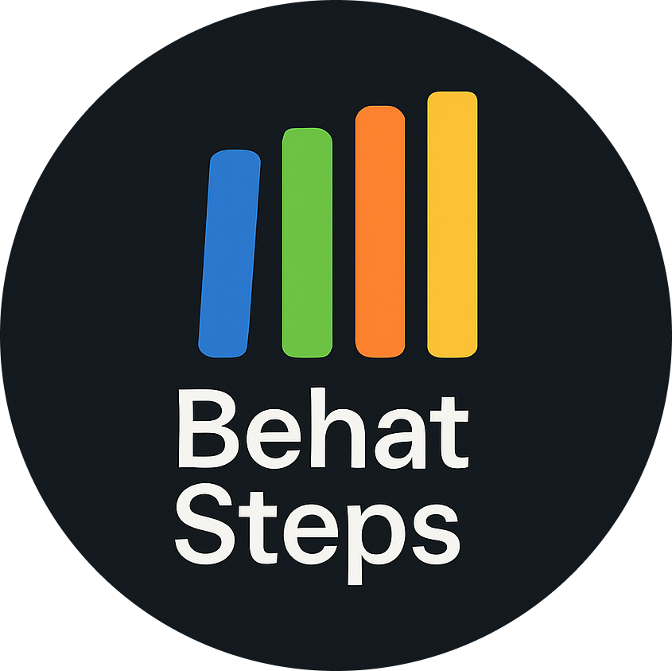

<p align="center">
  <a href="https://behat-steps.drevops.com" rel="noopener"></a>
</p>

<h1 align="center">Behat Steps</h1>

<h3 align="center">A collection of Behat steps for PHP and Drupal projects</h3>

<div align="center">

[](https://github.com/drevops/behat-steps/issues)
[](https://github.com/drevops/behat-steps/pulls)
[](https://github.com/drevops/behat-steps/actions/workflows/test.yml)
[](https://codecov.io/gh/drevops/behat-steps)


[](https://packagist.org/packages/drevops/behat-steps)

[](https://github.com/drevops/vortex)

[](https://drupal.slack.com/archives/C4T2JHG9K)

[Read the documentation](https://behat-steps.drevops.com)
</div>

---

[Behat](https://behat.org) lets you write tests as plain-English scenarios, then runs them against your site:

```gherkin
Feature: Contact page

  Scenario: Visitor finds the contact page
    When I visit "/contact"
    Then the response status code should be 200
    And I should see the heading "Contact"
```

Behat can only run a step once some PHP code stands behind it, and Behat Steps is that code, already written and tested. It ships steps that work on any website and steps that only mean something on a Drupal site. Every step is a thin wrapper over named helpers, which your own steps can call too.

## Features

- [Web](https://behat-steps.drevops.com/web-steps) and [Drupal](https://behat-steps.drevops.com/drupal-steps) steps for pages, forms, APIs, email, caches, content and more, with an example for each.
- [Helpers](HELPERS.md) behind every step, for the steps you write in your project's own words.
- [Backends](https://behat-steps.drevops.com/guides/configuration#backend-resolution) picked by capability, so a step runs in-process or through Drush.
- Support for Behat 3.33+ and Behat 4, Drupal 11 and 12, and PHP 8.3 to 8.5.
- BrowserKit, Selenium and Chrome DevTools [browser drivers](https://behat-steps.drevops.com/installation#javascript-browser-drivers).
- [Cleanup](https://behat-steps.drevops.com/guides/usage#entities-a-scenario-creates) of the entities a scenario creates.
- Step and helper references that ship with the package, for [AI coding agents](https://behat-steps.drevops.com/guides/ai-assistants), and a skill that has the agent write a step of your own on the helpers.

## Installation

```bash
composer require --dev drevops/behat-steps:^4
```

Composer installs Behat, Mink and the rest of what the steps run on along with it. A few steps need a package of their own, which Behat Steps suggests rather than requires:

<!-- cspell:ignore dmore justinrainbow lullabot softcreatr -->

- `softcreatr/jsonpath` and `justinrainbow/json-schema` for the JSON path and JSON schema steps.
- `lullabot/mink-selenium2-driver` or `dmore/behat-chrome-extension` for `@javascript` scenarios, which drive a real browser.

The [Quick start](https://behat-steps.drevops.com/quick-start) takes you from here to a passing scenario, and [Installation](https://behat-steps.drevops.com/installation) covers the optional dependencies and the JavaScript browser drivers. New to Behat? [Key concepts](https://behat-steps.drevops.com/concepts) explains its moving parts in plain words.

## Migrating from 3.x

[MIGRATION.md](MIGRATION.md) takes a project from 3.14 to 4.0, and an AI coding agent can apply it for you. [Migrating from 3.x](https://behat-steps.drevops.com/migrating) shows how.

## Writing tests with AI assistants

The step and helper references ship with the package as [STEPS.md](STEPS.md) and [HELPERS.md](HELPERS.md), so a coding agent in your project reads them from `vendor/drevops/behat-steps/`. The [create-behat-step](skills/create-behat-step/SKILL.md) skill ships beside them: describe a step, and your agent writes it on the helpers, in a trait your `FeatureContext` uses. [Writing tests with AI assistants](https://behat-steps.drevops.com/guides/ai-assistants) has a snippet for your `CLAUDE.md` or `AGENTS.md`, and shows how to install the skill.

## Contributing

Contributions are welcome. [CONTRIBUTING.md](CONTRIBUTING.md) holds the rules for code in this repository and the local development setup. The documentation site's [Contributing](https://behat-steps.drevops.com/contributing) section walks through a code change and writing the docs.

---
_This repository was created using the [Scaffold](https://getscaffold.dev/) project template_
