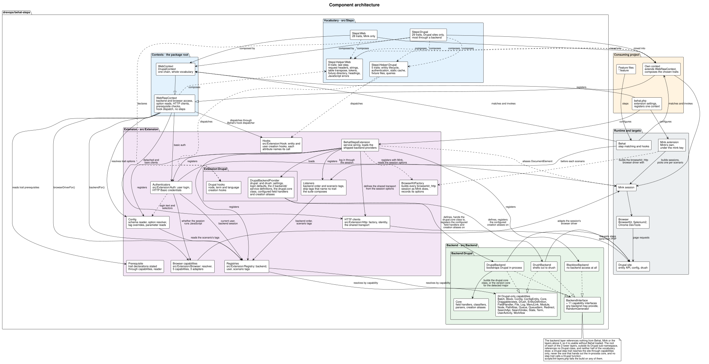

# Behat Steps

Behat Steps is a collection of reusable testing actions and assertions for automated testing with [Behat](https://behat.org). The steps most projects need are already written and documented, so you can write tests faster and keep them readable and maintainable.

The steps come as PHP traits: 28 that work on any website, and 29 that only mean something on a Drupal site. Every method starts with the name of the trait that declares it, such as `cookieGetAll()` in `CookieTrait`, so none of them collides with a method in your own context. Step text can still collide: Behat refuses to register 2 definitions with the same pattern, so drop any step of your own whose text matches a shipped one, or [compose your own context](guides/usage.md#compose-your-own-context) without that trait.

The library [tests its own steps](../../tests/behat/features) to avoid false positives and negatives, and every step follows [the same wording rules](../../CONTRIBUTING.md#steps-format), so the language stays consistent from one trait to the next.

## What you get

- [Steps](steps/README.md) lists every step, with a page per trait and an example for each step.
- Every step is a thin wrapper over named [helpers](helpers/README.md), so your own domain steps can call the same code.
- A step names the capability it needs rather than a [backend](guides/configuration.md#backend-resolution), so a step whose capability Drush provides, such as clearing caches or creating users, runs through Drush as well as in-process.
- Behat 3.33+ and Behat 4, Drupal 11 and 12, and PHP 8.3 to 8.5 are [supported](#supported-versions).
- The library supports the BrowserKit, Selenium and Chrome DevTools [browser drivers](installation.md#javascript-browser-drivers).
- After each scenario, the library [deletes the entities](guides/usage.md#entities-a-scenario-creates) that scenario's steps created, in reverse creation order.
- The step and helper references ship with the package as Markdown, so an [AI coding agent](guides/ai-assistants.md) in your project reads the same reference you do.
- [Architecture](architecture/README.md) explains how the layers fit together, with UML diagrams, and an AI agent maintains it through the `update-architecture-docs` skill.

## How it fits together

Your project registers 1 of the shipped contexts, or composes step traits into a context of its own, and registers the Behat Steps extension beside Mink's. The traits decide what each step does. A step that drives the page uses the browser session Mink's extension opens, and a step that needs the site itself names a capability, which the extension answers with the first backend in your `backends` list that provides it, such as Drupal or Drush.

[Usage](guides/usage.md) covers that model from your project's side, and [Architecture](architecture/README.md) walks through each layer.

## Supported versions

| Version | Behat | Drupal | PHP | Support |
| --- | --- | --- | --- | --- |
| 4.x | 3.33+, 4 | 11, 12 | 8.3, 8.4, 8.5 | The current major. Receives new features, bugfixes and security updates. |
| 3.x | 3 | 10, 11 | 8.2, 8.3, 8.4, 8.5 | The current minor is LTS until 1 July 2027 and receives bugfixes and security updates only. |
| 2.x | 3 | 9, 10 | 8.2+ | Unsupported |

## Where to next

- If you're new to Behat Steps, start with [Installation](installation.md), then the [Quick start](quick-start.md).
- To upgrade a 3.x project, see [Migrating from 3.x](migrating.md), which covers the migration guide and the AI agent skill that applies it.
- For steps of your own, [Scenario styles](guides/scenario-styles.md) explains when they pay off, and [Helpers](helpers/README.md) lists what they can call.
