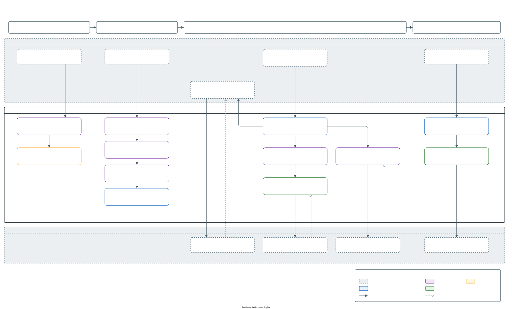

# Architecture

Behat Steps in 3 views. The [logical architecture](#logical-architecture) shows the parts and which way they depend on each other, the [class inheritance](#class-inheritance) shows what extends what, and the [data flow](#data-flow) shows what runs when. Select a diagram to open it at full size.

An AI agent maintains this page and its diagrams through the `update-architecture-docs` skill in [.claude/skills/update-architecture-docs/SKILL.md](../../../.claude/skills/update-architecture-docs/SKILL.md), which draws them with the [drawio-skill](https://github.com/Agents365-ai/drawio-skill). Everything here is traced from the source code, and where the 2 disagree, the code wins.

Looking for a reference instead? [Web steps](../web-steps/README.md) and [Drupal steps](../drupal-steps/README.md) list the steps, [Web helpers](../web-helpers/README.md) and [Drupal helpers](../drupal-helpers/README.md) list the toolbox behind them, and [Configuration](../guides/configuration.md) lists the options and tags.

## Logical architecture

[](logical-architecture.svg)

The library is 3 layers with 3 contexts on top, and every dependency points down:

- **Contexts.** `WebRawContext` registers no steps: it hands the traits their backends, browser capabilities, HTTP clients and options. `WebContext` adds the 28 web step traits, and `DrupalContext` adds the 29 Drupal ones. A project registers 1 of them, or a context of its own that extends 1.
- **Step vocabulary**, `src/Steps`. The step traits under `Steps\Web` and `Steps\Drupal`, and the 13 helper traits under `Steps\Helper`, which register no steps. A step body stays thin: it parses its arguments, then calls named helpers on its own trait, a helper trait it composes or `WebRawContext`, or Mink's session directly.
- **Extension layer**, `src/Extension`. `BehatStepsExtension` wires the library into Behat: the listeners and registries that set up each scenario, option resolution, the authenticators, the HTTP clients and the creation hooks. The layer also holds the prerequisite declarations with their reader, and the browser capability adapters with their resolver, which `WebRawContext` builds itself.
- **Backend layer**, `src/Backend`. A backend talks to the site and knows nothing about Behat. `BackendInterface` declares only bootstrapping and a random value generator, and everything else a backend can do is a capability interface. `DrupalBackend` runs Drupal in the same PHP process and provides 34 of the 35 capabilities, `DrushBackend` runs `drush` and provides 14, and `BlackboxBackend` provides none, for a site the suite can only browse.

A step never names a backend. It asks for a capability, and `BackendRegistry` answers with the first backend in the scenario's order that provides it. That's why the same steps run in-process, over Drush, or on a backend of a project's own.

`scripts/lint-layers.php` keeps the arrows pointing down: `src/Backend` references no Behat, Mink, extension or step code, and `src/Extension` no step code. [Layers](../../../CONTRIBUTING.md#layers) explains the boundaries, and [Sending a request from a trait](../../../CONTRIBUTING.md#sending-a-request-from-a-trait) lists every rule the script checks.

Beside the library sits the tooling that ships with the repository but not with the package. `docs.php` reflects `WebContext` and `DrupalContext` to write the step and helper references, `docs/` builds this site, `scripts/provision.php` builds the fixture Drupal site, and `tests/` runs the unit, kernel and Behat suites against it.

## Class inheritance

[](class-inheritance.svg)

The diagram holds 7 inheritance trees, 1 per panel:

- **Contexts.** `WebRawContext` extends Mink's `RawMinkContext` and implements `BackendAwareInterface`, which the context initializer injects the extension's services through. `DrupalContext` adds `UserAwareInterface`, for the user registry and the authenticator. A project's context extends 1 of the 3.
- **Backends.** A backend declares each capability it provides as an interface it implements, most of them through its own backend interface, so asking whether it provides 1 is an `instanceof`. `DrupalBackend` hands the Drupal work to `Core`, which the `drupal.core` option replaces.
- **Field handlers.** 1 handler per field type, all built on `AbstractHandler`. The `drupal.field_handlers` option adds a handler or replaces a shipped one.
- **Creation aliases.** A creation alias handles a column an entity can't take as written: `AuthorAlias` turns an author's name into a `uid` before a node is created, and `RolesAlias` assigns a user's roles after the user is created.
- **Browser adapters.** 1 adapter per browser driver family, declaring the browser capabilities that driver provides. A step asks for a capability such as `JavascriptCapabilityInterface`, never for a browser driver.
- **Entity creation hooks.** Each hook attribute, such as `#[BeforeEntityCreate]`, names a call class built on `EntityHook`, and the hook's scope carries the stub of the entity being created.
- **Exceptions.** What a failing step throws is part of the public contract, and [Exception types](../../../CONTRIBUTING.md#exception-types) says which one when.

Each of these interfaces has 1 implementation in the package. [Extending the extension layer](../extending/extension.md) shows how to put a class of your own in place of the registries, the authenticators, the random generator and the 2 factories:

| Interface | Implementation |
| --- | --- |
| `Extension\Registry\BackendRegistryInterface` | `BackendRegistry` |
| `Extension\Registry\ScenarioTagRegistryInterface` | `ScenarioTagRegistry` |
| `Extension\Registry\UserRegistryInterface` | `UserRegistry` |
| `Extension\Auth\AuthenticatorInterface`, `FastLogoutInterface` | `Authenticator` |
| `Extension\Auth\BasicAuthenticatorInterface` | `BasicAuthenticator` |
| `Extension\Http\HttpClientFactoryInterface` | `HttpClientFactory` |
| `Extension\Config\TraitOptionResolverFactoryInterface` | `TraitOptionResolverFactory` |
| `Extension\Config\TraitOptionResolverInterface` | `TraitOptionResolver` |
| `Extension\ServiceContainer\BackendProviderInterface` | `Extension\Drupal\ServiceContainer\DrupalBackendProvider` |
| `Backend\Entity\EntityStubInterface` | `EntityStub` |
| `Backend\Random\RandomGeneratorInterface` | `RandomGenerator` |
| `Backend\Drupal\Core\Field\FieldClassifierInterface` | `FieldClassifier` |
| `Backend\Drupal\Core\Field\FieldShapeClassifierInterface` | `FieldShapeClassifier` |
| `Backend\Drupal\Core\Field\Parser\EntityFieldParserInterface` | `EntityFieldParser` |

These types are where the library plugs into Behat, Mink and Symfony:

| Type | Extends or implements |
| --- | --- |
| `Extension\ServiceContainer\BehatStepsExtension` | `Behat\Testwork\ServiceContainer\Extension` |
| `Extension\ServiceContainer\BackendPass` | `Symfony\Component\DependencyInjection\Compiler\CompilerPassInterface` |
| `Extension\ServiceContainer\Driver\BrowserKitFactory` | `Behat\MinkExtension\ServiceContainer\Driver\BrowserKitFactory`, which it replaces for `browserkit_http` sessions |
| `Extension\Context\BackendAwareInterface`, `UserAwareInterface` | `Behat\Behat\Context\Context` |
| `Extension\Context\Initializer\BackendAwareInitializer` | `Behat\Behat\Context\Initializer\ContextInitializer` |
| `Extension\Context\Attribute\HookAttributeReader` | `Behat\Behat\Context\Attribute\AttributeReader` |
| `Extension\Hook\Call\EntityHook` | `Behat\Testwork\Hook\Call\RuntimeHook` |
| `Extension\Hook\Scope\EntityScopeInterface` | `Behat\Testwork\Hook\Scope\HookScope` |
| `Extension\Listener\BackendListener`, `SkipTagListener` | `Symfony\Component\EventDispatcher\EventSubscriberInterface` |
| `Extension\Selector\RegionSelector` | `Behat\Mink\Selector\SelectorInterface` |
| `Extension\Generator\ClassGenerator` | `Behat\Behat\Context\ContextClass\ClassGenerator` |
| `Extension\Browser\Element\DocumentElement` | `Behat\Mink\Element\TraversableElement`, aliased over Mink's `DocumentElement` so page text reads as a browser renders it |

## Data flow

[](data-flow.svg)

Behat owns the loop, and the library runs at 4 points in it. The diagram numbers every step in the order it runs and colors it by the part of the system that runs it:

1. **The suite starts.** Behat loads `BehatStepsExtension`, which wires the services and registers the backends: `blackbox` always, `drupal` and `drush` when the configuration has a section for them, and any tagged backend of a project's own. `WebContext::assertOneContext()` fails a suite that registers 2 of the shipped contexts, since both would register every web step.
2. **A scenario starts.** Behat builds fresh contexts, and `BackendAwareInitializer` injects the extension's services into each. `SkipTagListener` rejects a `@behat-steps-skip:` tag that names no composed trait. `BackendListener` gives `BackendRegistry` the scenario's backend order: the configured `backends` list, with any backend a `@backend:` tag names moved to the front. Then the traits' `BeforeScenario` hooks run: a hook with something to switch off asks `skipTag()` first, and a trait that needs something from the site before its first step, such as `WatchdogTrait`, calls `assertPrerequisites()`, which fails the scenario when the site lacks it.
3. **Each step runs.** Behat matches the Gherkin line to a `#[Given]`, `#[When]` or `#[Then]` attribute on a trait method and calls it on the context. The step reaches out 1 of 3 ways: it drives the page through the Mink session, it asks `backendFor()` for a capability to read or change the site, or it sends a request of its own through 1 of the 3 HTTP clients. It then asserts on what came back, and a failure throws.
4. **The scenario ends.** `EntityLifecycleTrait` deletes what the scenario created, newest first, and `AuthTrait` deletes the scenario's users and then its roles, each through the capability that deletes that entity type.

## Diagram sources

Each diagram is a draw.io source beside the SVG this page embeds. Both are committed, so a reviewer sees the source diff and the rendered result.

| Diagram | Source | Render |
| --- | --- | --- |
| Logical architecture | `logical-architecture.drawio` | [`logical-architecture.svg`](logical-architecture.svg) |
| Class inheritance | `class-inheritance.drawio` | [`class-inheritance.svg`](class-inheritance.svg) |
| Data flow | `data-flow.drawio` | [`data-flow.svg`](data-flow.svg) |

To change a diagram by hand, open its source in [draw.io](https://www.drawio.com/), save it, then export every SVG again from the repository root:

```bash
php scripts/draw-diagram.php --export docs/content/architecture
```

Each SVG records the hash of the source it came from, and `php scripts/draw-diagram.php --check docs/content/architecture`, which the unit suite runs too, fails an SVG exported from an older source.

After a structural change - a new layer or namespace, a new backend or capability, a change to an inheritance tree or to the scenario lifecycle - ask the AI agent to "update architecture docs". It re-traces the affected diagrams from the current code and redraws them through the `update-architecture-docs` skill.
