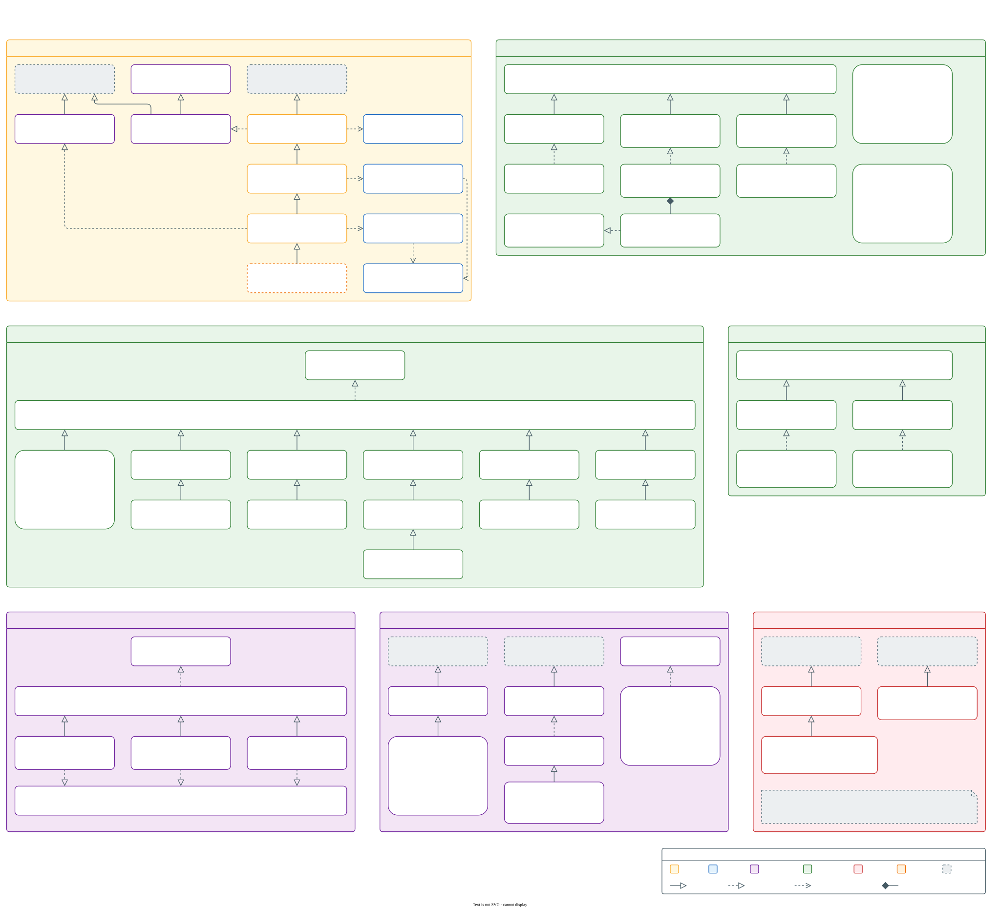

# Class inheritance

This view shows what extends what. Select the diagram to open it at full size.

The diagram holds 7 inheritance trees, 1 per panel:

- **Contexts.** `WebRawContext` extends Mink's `RawMinkContext` and implements `BackendAwareInterface`, which the context initializer injects the extension's services through. `DrupalContext` adds `UserAwareInterface`, for the user registry and the authenticator. Your project's context extends 1 of the 3.
- **Backends.** A backend declares each capability it provides as an interface it implements, most of them through its own backend interface, so asking whether it provides 1 is an `instanceof`. `DrupalBackend` hands the Drupal work to `Core`, which the `drupal.core` option replaces.
- **Field handlers.** 1 handler per field type, all built on `AbstractHandler`. The `drupal.field_handlers` option adds a handler or replaces a shipped one.
- **Creation aliases.** A creation alias handles a column an entity can't take as written: `AuthorAlias` turns an author's name into a `uid` before a node is created, and `RolesAlias` assigns a user's roles after the user is created.
- **Browser adapters.** 1 adapter per browser driver family, declaring the browser capabilities that driver provides. A step asks for a capability such as `JavascriptCapabilityInterface`, never for a browser driver.
- **Entity creation hooks.** Each hook attribute, such as `#[BeforeEntityCreate]`, names a call class built on `EntityHook`, and the hook's scope carries the stub of the entity being created.
- **Exceptions.** What a failing step throws is part of the public contract, and [Exception types](../../../CONTRIBUTING.md#exception-types) says which one when.

The services the extension builds each have 1 implementation of their interface, and [Extending the extension layer](../extending/extension.md) shows how to put a class of your own in place of one:

| Interface | Implementation |
| --- | --- |
| `Extension\Registry\BackendRegistryInterface` | `BackendRegistry` |
| `Extension\Registry\ScenarioTagRegistryInterface` | `ScenarioTagRegistry` |
| `Extension\Registry\UserRegistryInterface` | `UserRegistry` |
| `Extension\Auth\AuthenticatorInterface`, `FastLogoutInterface` | `Authenticator` |
| `Extension\Auth\BasicAuthenticatorInterface` | `BasicAuthenticator` |
| `Extension\Http\HttpClientFactoryInterface` | `HttpClientFactory` |
| `Extension\Config\TraitOptionResolverFactoryInterface` | `TraitOptionResolverFactory` |
| `Extension\Config\TraitOptionResolverInterface` | `TraitOptionResolver` |
| `Extension\ServiceContainer\BackendProviderInterface` | `Extension\Drupal\ServiceContainer\DrupalBackendProvider` |
| `Backend\Entity\EntityStubInterface` | `EntityStub` |
| `Backend\Random\RandomGeneratorInterface` | `RandomGenerator` |
| `Backend\Drupal\Core\Field\FieldClassifierInterface` | `FieldClassifier` |
| `Backend\Drupal\Core\Field\FieldShapeClassifierInterface` | `FieldShapeClassifier` |
| `Backend\Drupal\Core\Field\Parser\EntityFieldParserInterface` | `EntityFieldParser` |

These classes are where the library plugs into Behat, Mink and Symfony:

| Class | Extends or implements |
| --- | --- |
| `Extension\ServiceContainer\BehatStepsExtension` | `Behat\Testwork\ServiceContainer\Extension` |
| `Extension\ServiceContainer\BackendPass` | `Symfony\Component\DependencyInjection\Compiler\CompilerPassInterface` |
| `Extension\ServiceContainer\Driver\BrowserKitFactory` | `Behat\MinkExtension\ServiceContainer\Driver\BrowserKitFactory`, which it replaces for `browserkit_http` sessions |
| `Extension\Context\Initializer\BackendAwareInitializer` | `Behat\Behat\Context\Initializer\ContextInitializer` |
| `Extension\Context\Attribute\HookAttributeReader` | `Behat\Behat\Context\Attribute\AttributeReader` |
| `Extension\Listener\BackendListener`, `SkipTagListener` | `Symfony\Component\EventDispatcher\EventSubscriberInterface` |
| `Extension\Selector\RegionSelector` | `Behat\Mink\Selector\SelectorInterface` |
| `Extension\Generator\ClassGenerator` | `Behat\Behat\Context\ContextClass\ClassGenerator` |
| `Extension\Browser\Element\DocumentElement` | `Behat\Mink\Element\TraversableElement`, aliased over Mink's `DocumentElement` so page text reads as a browser renders it |
