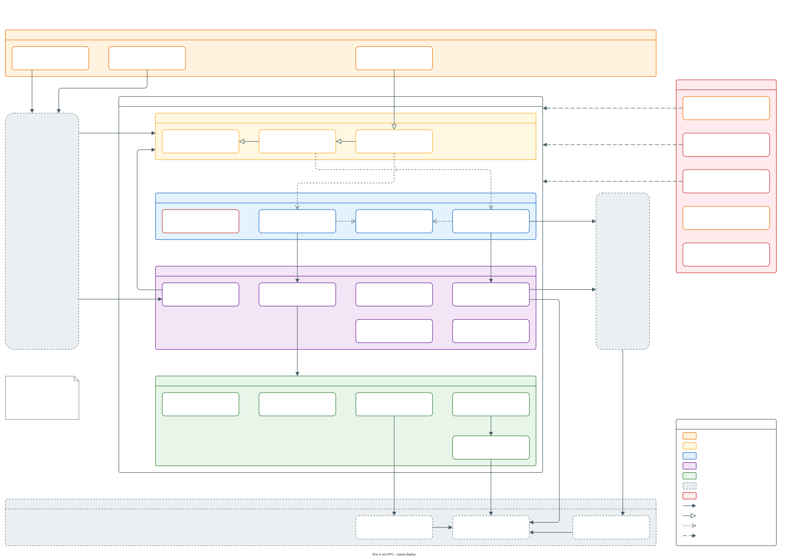

# Key concepts

The [quick start](quick-start.md) had you write a `behat.php`, a feature file and a step of your own. This page explains what each of those pieces is, how Behat and Mink run them, and what Behat Steps adds on top. If you've used Behat before, skip ahead to [What Behat Steps adds](#what-behat-steps-adds).

## How Behat runs a scenario

Behat is a PHP tool that runs tests written as plain-text scenarios. You keep them in feature files, which end in `.feature` and use a format called Gherkin:

```gherkin
Feature: Homepage

  Scenario: Visitor opens the homepage
    When I visit "/"
    Then the response status code should be 200
    And I should see the heading "Welcome!"
```

Each line under `Scenario:` is a step. `Given` sets up what a scenario needs, `When` does the thing you're testing, and `Then` checks the result. `And` and `But` continue whichever keyword came before them.

Behat doesn't read English, though. It matches each step against step definitions: PHP methods carrying an attribute with a pattern. This is the definition behind the first step above:

```php
#[When('I visit :path')]
public function pathVisit(string $path): void {
  $this->getSession()->visit($this->locatePath($path));
}
```

`:path` is a placeholder. Behat captures the quoted value in that position, `"/"` here, and passes it to the method. A step that matches no definition is reported as undefined.

Step definitions live in contexts. A context is a PHP class, and Behat builds a fresh instance of every context for every scenario, so each scenario starts from a clean object. A context can also hold hooks: methods that run before or after a scenario or a step. Behat Steps uses hooks to check for errors and to clean up after each scenario.

Your configuration file ties it all together:

- A suite pairs a folder of feature files with the contexts their steps come from. Most projects have 1, and [Configuration](guides/configuration.md#1-suites-and-context-arguments) shows when several pay off.
- A profile holds your suites and the extensions they need. Behat runs the `default` profile unless you name another with `--profile`.
- An extension plugs into Behat itself. Mink's extension gives your scenarios a browser, and Behat Steps' extension connects its steps to your site.

Behat 4 reads this configuration only from PHP, in `behat.php`, or `behat.dist.php` when there's no `behat.php`. Behat 3 also reads `behat.yml`.

## Where Mink comes in

Mink is the library Behat uses to drive a browser. A step that visits a page, clicks a link or reads text does it through a Mink session, a browser Mink controls for your scenarios.

Each session runs on a browser driver, and the 2 kinds behave differently:

- BrowserKit, behind the `browserkit_http` session in the quick start, sends HTTP requests from PHP and reads the HTML that comes back. It's fast, and it doesn't run JavaScript.
- Selenium and Chrome drive a real browser, so the page's JavaScript runs. A scenario tagged `@javascript` uses this kind of session, and [JavaScript browser drivers](installation.md#javascript-browser-drivers) covers setting 1 up.

Mink also ships `MinkContext`, a context with Mink's own basic steps, such as `I fill in "Title" with "About us"` and `I press "Save"`. You register it beside a Behat Steps context.

## What Behat Steps adds

### Steps, grouped in traits

Behat Steps ships its step definitions as PHP traits, each holding the steps for 1 job, such as cookies, forms, links, content or users. 28 traits work on any website, and 29 only make sense on a Drupal site. [Web steps](web-steps/README.md) and [Drupal steps](drupal-steps/README.md) list every step with an example.

### 3 contexts, each building on the last

You don't register the traits 1 by 1. The library composes them into 3 contexts, and each one extends the one above it:

1. `WebRawContext` extends Mink's `RawMinkContext` and adds backend access, configuration, hook dispatch and 3 web helper traits. It has no steps.
2. `WebContext` extends `WebRawContext` and adds every trait under `Steps\Web`, 28 in all.
3. `DrupalContext` extends `WebContext` and adds every trait under `Steps\Drupal`, 29 in all.

Because each context extends the one above it, `DrupalContext` already holds every web step. That's why your suite registers exactly 1 of them:

- `WebContext` for any website.
- `DrupalContext` for a Drupal site.
- `WebRawContext` as the base of a context of your own that picks its traits, as [Compose your own context](guides/usage.md#compose-your-own-context) shows.

If a suite registers both `WebContext` and `DrupalContext`, every web step would be defined twice. Behat Steps stops the run before the first scenario, with a message telling you to keep only 1.

### Helpers behind every step

Every step is a thin wrapper over public methods called helpers. The step `the cookie :name should exist` is 1 line that calls `cookieAssertExists()`. Your own steps call the same helpers on `$this`, so a step in your project's own words takes a few lines of PHP. [Scenario styles](guides/scenario-styles.md) explains when that pays off.

Each helper's name starts with the name of its trait, such as `cookieGetAll()` in `CookieTrait`, so none collides with a method in your own context. [Web helpers](web-helpers/README.md) and [Drupal helpers](drupal-helpers/README.md) list them all.

### The extension and its settings

`BehatStepsExtension` connects the steps to Behat. It reads its settings from your `behat.php`: which backends the steps may use, what your login form looks like, which CSS selector each named region of your pages has, and the defaults of the traits' own options. A plain website needs none of them, and [Configuration](guides/configuration.md#2-the-behat_steps-extension-key) lists them all.

### Backends: reaching the site without the browser

Some steps need the site itself rather than a page. `Given the following "page" content exists:` creates pages directly in Drupal, without going through its forms. A step like that reaches the site through a backend:

- `drupal` bootstraps Drupal inside the Behat process and calls its API.
- `drush` runs Drush commands against the site.
- `blackbox` stands for a site you can only browse, and does nothing on its own.

A step never names a backend. It asks for a capability, such as creating content or clearing caches, and the first backend in your `backends` list that provides it does the work. So the same step can run in-process or through Drush, depending on that list. [Backend resolution](guides/configuration.md#backend-resolution) covers the details.

### Cleanup after each scenario

Whatever the library's steps create, such as content, users or roles, the library deletes when the scenario ends, newest first, so your test site stays clean across long runs. A step of your own gets the same cleanup when it creates entities through the `entityLifecycleCreate*()` helpers, and otherwise has to [register what it creates](extending/steps.md#register-what-it-creates). [Entities a scenario creates](guides/usage.md#entities-a-scenario-creates) covers keeping them when you're debugging.

### Checks, tags and options

Some traits run checks around every scenario instead of waiting to be called as a step. `WatchdogTrait`, which `DrupalContext` includes, fails a scenario that logs a PHP error, and `JavascriptTrait` fails one that hits a JavaScript error.

Tags are Gherkin's labels for a scenario or a feature, such as `@javascript`. Behat Steps reads tags of its own, such as `@behat-steps-skip:WatchdogTrait`, which switches a trait's checks off for 1 scenario. Many traits also declare options, settings you can change for the whole profile, for 1 context or for 1 scenario. [Configure a trait](guides/usage.md#configure-a-trait) shows how, and [Configuration](guides/configuration.md#3-tags) lists every tag.

## The big picture

Your project registers 1 of the shipped contexts, or a context of its own, and the Behat Steps extension beside Mink's. The traits decide what each step does. A step that drives the page uses the browser session Mink's extension opens, and a step that needs the site itself asks for a capability, which the first backend in your `backends` list that provides it answers.

[](architecture/logical-architecture.svg)

[Logical architecture](architecture/logical-architecture.md) walks through each layer of that diagram.

## Words you'll see in these docs

| Term | What it means |
| --- | --- |
| Backend | How a step reaches the site without the browser: `drupal`, `drush` or `blackbox` |
| Browser driver | What runs behind a Mink session: BrowserKit for plain HTTP, Selenium or Chrome for a real browser |
| Capability | A job a backend can do, such as creating content. A step asks for a capability, never for a backend |
| Context | A PHP class holding step definitions and hooks. Behat builds a fresh one for every scenario |
| Extension | A package that plugs into Behat, such as Mink's extension or `BehatStepsExtension` |
| Feature file | A `.feature` file holding a feature and its scenarios, written in Gherkin |
| Gherkin | The plain-text format of feature files, built on `Feature:`, `Scenario:`, `Given`, `When` and `Then` |
| Helper | A public method a step is built on, which your own steps can call too |
| Hook | A method that runs before or after a scenario or a step |
| Mink session | A browser Mink controls for your scenarios |
| Profile | A named set of suites and extensions in `behat.php` |
| Scenario | 1 example of how your site should behave, as a list of steps |
| Step | 1 line of a scenario |
| Step definition | The PHP method behind a step, matched by the pattern in its attribute |
| Suite | A set of feature files and the contexts their steps come from |
| Tag | A label such as `@javascript` on a scenario or a feature, which changes how it runs |
| Toolbox | The library's helpers as a whole |
| Trait | A PHP trait grouping the steps or the helpers for 1 job |
| Trait option | A setting a trait declares, such as `ajax_timeout` in the `wait` group |
| Vocabulary | The library's steps as a whole |
